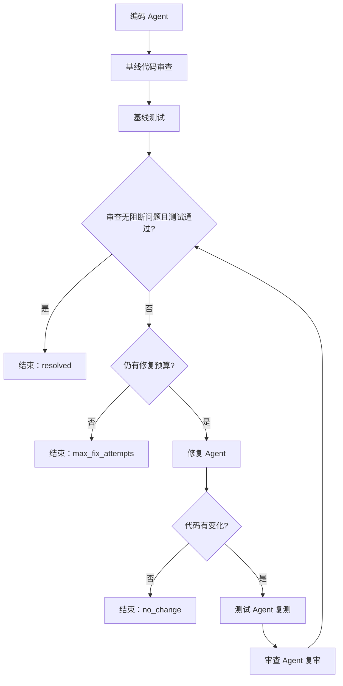

# Intelligent Agent Workflow（开发版）

一个基于多 Agent 协作的代码审查工作流系统，实现代码生成、代码审查、自动化测试和迭代修复的完整流程。

**当前仓库是开发版 `intelligent-agent-workflow-dev`。** 开发仓库地址：[adogfm/intelligent-agent-workflow-dev](https://github.com/adogfm/intelligent-agent-workflow-dev)。本页的克隆、安装和运行命令均针对开发版。

原项目作为[稳定版仓库](https://github.com/adogfm/intelligent-agent-workflow)保留，开发与修复在当前开发仓库进行。

## 一、项目简介

本项目旨在探索多 Agent 协作与 Workflow 编排机制，通过将代码生成、代码审查、测试执行和代码修复组织为一个完整的工作流，展示 Agent 之间的协作、状态共享和流程控制。

系统以 `add(a, b)` 函数为演示场景，故意引入初始代码缺陷，通过代码审查、自动化测试和条件分支判断，触发后续修复流程，直到审查无阻断问题且测试通过，或因修复预算耗尽、代码无变化、执行异常而停止。

## 二、主要功能

- **多 Agent 协作：** 由编码、审查、测试和修复等 Agent 协同完成任务。
- **共享状态管理：** 在工作流执行过程中共享代码、审查结果、测试结果和修复记录。
- **条件分支：** 根据代码审查与测试结果动态决定下一步执行阶段。
- **迭代修复：** 当测试失败或审查发现问题时，进入修复流程，并重新测试和审查。
- **执行日志：** 记录工作流阶段、路由选择、状态更新和 Agent 执行事件。
- **执行结果追踪：** 汇总阶段执行情况、修复轮数、测试结果和最终审查结果。
- **有限循环与终止机制：** 设置最大修复轮数，避免工作流无限循环。
- **自动化测试：** 提供测试用例，验证 Agent 和工作流的关键行为。

## 三、工作流程

下图对应 `demo.py` 和显式设置 `max_fix_attempts` 的自动修复模式：



清洁基线按“编码 → 审查 → 测试 → 结束”执行，不额外复审。测试失败或审查仍有阻断问题，都会在预算允许时进入修复。改码后必须先复测、再复审；任何节点异常都可能以 `failed` 提前终止。

未设置 `max_fix_attempts` 的单轮模式只修复一次，改码后按已配置节点执行复验；同时启用审查和测试时，顺序为“复审 → 复测”。只有 `create_fix_workflow()` 的单节点修复不自动复验，报告会将尚缺当前验收证据的结果标记为 `unresolved`。

## 四、项目结构

```text
intelligent-agent-workflow-dev/
├── workflow/          # 工作流编排与流程控制
├── tests/             # 自动化测试
├── demo.py            # 完整工作流演示
├── coding_agent.py    # 编码 Agent
├── fix_agent.py       # 代码修复 Agent
├── code_checker.py    # 代码检查与验证
├── planner.py         # 任务规划
├── models.py          # 数据模型与状态定义
├── agent.py           # Agent 相关实现
├── test_agent.py      # 测试 Agent
├── README.md          # 项目说明
└── Design.md          # 架构与设计文档
```

## 五、环境要求

- Python >=3.10。
- 运行依赖见 `requirements.txt`；pytest 测试依赖由 `pyproject.toml` 的 `test` 可选依赖组声明。

## 六、安装与运行

### 1. 克隆开发仓库

```powershell
git clone https://github.com/adogfm/intelligent-agent-workflow-dev.git
cd intelligent-agent-workflow-dev
```

在已有目录中继续开发时，可核对仓库来源：

```powershell
git remote get-url origin
```

结果应为 `https://github.com/adogfm/intelligent-agent-workflow-dev.git`（已有配置也可能省略末尾 `.git`），目录名应为 `intelligent-agent-workflow-dev`。

### 2. 安装依赖

在开发版目录中建立独立 `.venv`。稳定版和开发版分别使用各自的虚拟环境，避免同名包的 editable 安装相互覆盖。

Windows PowerShell 下，在开发版根目录创建独立环境并安装项目与测试依赖：

```powershell
python -m venv .venv
.\.venv\Scripts\python.exe -m pip install -e ".[test]"
.\.venv\Scripts\python.exe -m pip check
```

以下 Windows 命令显式使用开发版 `.venv`，无需激活环境。命令行入口也使用 `.\.venv\Scripts\code-review-agent.exe` 等完整路径。Linux/macOS 对应的 Python 路径为 `./.venv/bin/python`。

仅运行源码和离线 Demo 时，也可在该虚拟环境中只安装运行依赖：

```powershell
.\.venv\Scripts\python.exe -m pip install -r requirements.txt
```

`test` 依赖组包含 `pytest>=9.1.1,<10.0.0`，并同时安装项目运行依赖。默认 Demo 使用确定性离线供应商，无需 API Key；真实模型接口通过 `.env.example` 中的配置启用，本次验证未调用真实模型。

### 3. 运行工作流演示

```powershell
.\.venv\Scripts\python.exe demo.py
```

程序将展示 Agent 执行过程、条件分支选择、自动修复循环、执行日志以及最终工作流报告。

### 4. 运行自动化测试

安装 `.[test]` 后运行 pytest：

```powershell
.\.venv\Scripts\python.exe -m pytest -v
```

也可只使用运行依赖，通过 Python 标准库运行相同测试方法：

```powershell
.\.venv\Scripts\python.exe -m unittest discover -s tests -v
```

pytest 会额外单独统计 `unittest.subTest` 子测试；unittest 的测试方法总数不含这些子测试的单独计数。

pytest 默认只在 `tests/` 中发现测试；根目录的 `test_agent.py`、`test_feedback.py` 和 `test_worker.py` 是业务模块。测试中导入的非测试 `Test*` 类型使用别名，避免被当作测试类收集。CI 将收集警告视为错误，可在本地执行相同检查：

```powershell
.\.venv\Scripts\python.exe -m pytest --collect-only -q -W error::pytest.PytestCollectionWarning
```

### 5. CLI 退出码

`code-review-agent` / `main.py` 返回 0 表示当前代码已通过配置的检查；审查存在阻断问题、启用的测试未通过或执行失败时返回 1；输入或配置错误返回 2。`recommendations` 中的可选建议不阻断成功。未启用的测试不会自动执行。

初始代码生成遇到 Python 语法或编译错误时，`CodingAgent` 默认最多重试 3 次（含首次调用共最多 4 次），耗尽后 CLI 返回 1。Python 接口可通过 `CodingAgent(generator, max_syntax_retries=0)` 关闭重试，或设置其他非负整数；该次数独立于 `max_fix_attempts`。重试保留原需求和上下文，附加上一次失败代码及语法诊断；鉴权、连接、JSON 或结构错误不触发此语法重试。

`--apply-fixes` 实际修改文件后，会再次执行代码审查，并结合修改后 CodeChecker 结果决定退出码。普通 MockReviewer 固定返回一个示例阻断问题，因此 Mock CLI 即使导入测试通过也返回 1；完整离线成功示例可运行 `demo.py`。

## 七、演示结果

演示程序以存在缺陷的 `add(a, b)` 函数为起点，展示系统如何通过测试与审查发现问题，并执行迭代修复。

本次已验证的演示结果：

- 工作流执行成功。
- 共执行 9 个阶段。
- 完成 2 轮代码修复。
- 最终代码审查评分为 100，未发现问题。
- 最终测试通过，3/3 项测试成功。
- 记录 56 条工作流日志。

最终代码如下：

```python
def add(a, b):
    return a + b
```

2026-10-23 本地验证结果（Windows、Python 3.14.3、pytest 9.1.1）：

- 232 项测试通过。
- 704 个子测试通过。
- 存在 39 条 Pytest 警告，主要涉及测试类的自动收集提示。

2026-10-29 开发版复验：261 项测试、847 个子测试通过，原有 39 条收集警告已清零，测试 ID 与处理前完全一致。处理方式与证据见 [F06 修复报告](reports/2026-10-29/F06修复报告.md)。

其他 Demo 入口：

```powershell
.\.venv\Scripts\python.exe demo.py --max-fix-attempts 0
.\.venv\Scripts\python.exe demo.py --max-fix-attempts 1
.\.venv\Scripts\python.exe demo.py --json
```

| 模式 | 业务结果 | 退出码 | 阶段 / 修复轮数 / 日志数 |
|---|---|---|---|
| 默认 | succeeded | 0 | 9 / 2 / 56 |
| 预算 0 | unresolved | 1 | 3 / 0 / 20 |
| 预算 1 | unresolved | 1 | 6 / 1 / 38 |
| `--json` | succeeded | 0 | 9 / 2 / 56 |

`--json` 在人类可读输出后附加 JSON，不是只输出 JSON。Demo 的生成、审查和修复供应商按预设场景返回结果；真实测试由 TestRunner 子进程执行。演示说明流程控制，不代表真实模型对任意任务的修复效果。

### 实现边界

- TestRunner 的超时控制与报告输出截断是不同机制。`max_output_bytes` 默认对 stdout、stderr 各读取前 64 KiB，再附加截断提示；运行时日志文件大小没有该上限，子进程也不是操作系统安全沙箱。
- WorkflowReport 顶层采用冻结 dataclass，内容复制后与原状态隔离；嵌套模型和容器仍可能可变，不保证深度不可变。
- 通用 Workflow 的 `succeeded` 与 CLI 的成功退出码只反映已配置检查与待复验要求，不表示未配置的检查也已执行，详见 Design.md。
- 初始生成和 CodeChecker 会解析并编译代码，拦截作用域等语法错误，校验过程不执行代码。可确定的文本 `%` 格式化已排除除零误报；AST 规则覆盖范围和动态类型推断仍有已知限制，详见 Design.md 第 7、14 节。
- Review 与 Fix 的业务规则和错误文案以用户明确需求为准，不预设注册密码策略。原测试与明确需求冲突时，要求在说明中保留冲突，不改写测试或宣称冲突已解决；提示词契约的离线验证不代表真实模型始终遵守这些规则。

## 八、设计文档

详细的系统架构、工作流编排、状态管理、条件分支和修复循环设计，请参阅 [Design.md](Design.md)。

## 九、项目目标总结

本项目通过一个可运行的多 Agent 工作流示例，展示 Agent 协作、状态共享、条件分支、循环控制、执行日志和自动化测试等核心机制，并为后续增加 Agent 类型、扩展流程节点和完善错误恢复机制提供基础。
